# Goated Goddess 1000 — Asset Redesign Prompts (Nano Banana Pro)

Local copy of the Claude Doc prompts. `manifest.json` holds the same prompts for `generate.py`. Images are attached in the order listed; the first is "Image 1". Jobs marked *+ master style* get this appended:

```
Semi-realistic digital illustration, clean line art, cel shading with soft painterly gradients. Premium dark slot game art. Palette limited to obsidian #16121F, blood crimson #C8102E, polished silver #C9CED6 and ember orange #FF7A1A, with shades of those four only. No text, no watermark, no border or badge frame. Solid flat pure #00FF00 green background with no gradient, no floor, no cast shadow.
```

## Symbols

### L1: L1 Crescent Moon (replaces Sapphire)

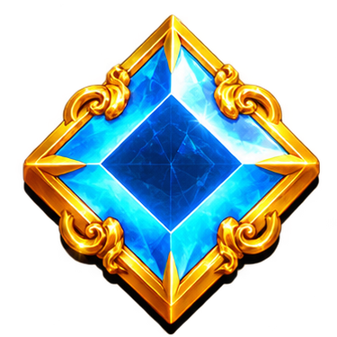

Attach: Image 1 = `refs/old-sapphire.png`, Image 2 = `refs/style-L4.png`. 1:1, 1K, 2 variant(s), + master style. Output: `final/symbols/L1_crescent.png`.

```
Image 1 is an old symbol from our slot game. Use it only for framing and scale; do not keep its subject, shape, colours, gold or badge. Image 2 is our approved Full Moon symbol from the same set: match its disc, bevel, silver rim, crater engraving and matte finish exactly so the four moons read as one set. The four moon symbols must be told apart at a glance at 96 px purely by how much of the moon is lit: crescent about 25%, half 50%, gibbous 75%, full 100%.

Create a low-value slot symbol on the same round matte obsidian disc: a crescent moon, about one quarter lit, drawn as a solid filled crescent of engraved polished silver with fine crater texture, bright against the dark disc. The unlit part of the moon is not drawn at all: no outline, no ring. Cool silver-grey rim, no copper, bronze or warm tones. Low contrast, no glow. Centred, filling about 85% of a 1:1 frame.
```

### L2: L2 Half Moon (replaces Emerald)

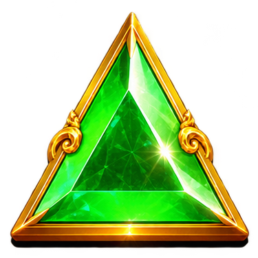

Attach: Image 1 = `refs/old-emerald.png`, Image 2 = `refs/style-L4.png`. 1:1, 1K, 2 variant(s), + master style. Output: `final/symbols/L2_half.png`.

```
Image 1 is an old symbol from our slot game. Use it only for framing and scale; do not keep its subject, shape, colours, gold or badge. Image 2 is our approved Full Moon symbol from the same set: match its disc, bevel, silver rim, crater engraving and matte finish exactly so the four moons read as one set. The four moon symbols must be told apart at a glance at 96 px purely by how much of the moon is lit: crescent about 25%, half 50%, gibbous 75%, full 100%.

Create a low-value slot symbol on the same round matte obsidian disc: a half moon. The left half is a solid filled half-disc of engraved polished silver with fine crater texture, cut by one perfectly straight vertical edge. The right half is not drawn at all: no outline, no extra lines. Cool silver-grey rim, no copper, bronze or warm tones. Low contrast, no glow. Centred, filling about 85% of a 1:1 frame.
```

### L3: L3 Gibbous Moon (replaces Amethyst)

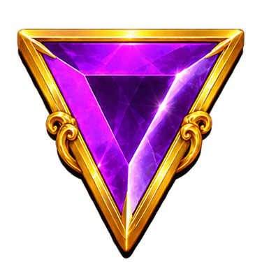

Attach: Image 1 = `refs/old-amethyst.png`, Image 2 = `refs/style-L4.png`. 1:1, 1K, 2 variant(s), + master style. Output: `final/symbols/L3_gibbous.png`.

```
Image 1 is an old symbol from our slot game. Use it only for framing and scale; do not keep its subject, shape, colours, gold or badge. Image 2 is our approved Full Moon symbol from the same set: match its disc, bevel, silver rim, crater engraving and matte finish exactly so the four moons read as one set. The four moon symbols must be told apart at a glance at 96 px purely by how much of the moon is lit: crescent about 25%, half 50%, gibbous 75%, full 100%.

Create a low-value slot symbol on the same round matte obsidian disc: a gibbous moon. About three quarters of the moon is a solid filled shape of engraved polished silver with fine crater texture; the unlit sliver on the right is not drawn at all, leaving a curved terminator. No outline of the dark part, no inner circle. Cool silver-grey rim, no copper, bronze or warm tones. Low contrast, no glow. Centred, filling about 85% of a 1:1 frame.
```

### L4: L4 Full Moon (replaces Ruby)

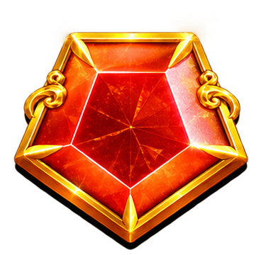

Attach: Image 1 = `refs/old-ruby.png`, Image 2 = approved L1. 1:1, 1K, 1 variant(s), + master style. Output: `final/symbols/L4_full.png`.

```
Image 1 is an old symbol from our slot game. Use it only for framing and scale; do not keep its subject, shape, colours, gold or badge. Image 2 is our approved new low symbol: match its disc, bevel, line weight and matte finish exactly.

Create a low-value slot symbol: a full moon with fine crater engraving in flat polished silver on the same round matte obsidian disc. A faint pale-steel rim. Low contrast, no glow. Centred, filling about 85% of a 1:1 frame.
```

### H1: H1 Flame Lantern (replaces Chalice)

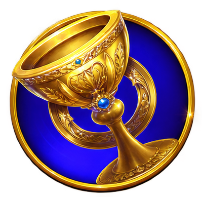

Attach: Image 1 = `refs/old-chalice.png`, Image 2 = approved L1. 1:1, 1K, 1 variant(s), + master style. Output: `final/symbols/H1_lantern.png`.

```
Image 1 is an old symbol from our slot game. Use it only for framing and level of finish; do not keep its subject, cup shape, gold, blue enamel or badge. Image 2 is our approved new style: match its line weight, cel shading and silver finish.

Create a premium slot symbol: an ornate polished-silver lantern with crescent-moon-shaped cage bars and a hooked hanging ring on top. A crimson flame burns inside with an ember-orange core, and a few ember sparks rise. Strong silver rim light; glow kept tight to the lantern. Premium and richer than the moon symbols. Centred, filling about 85% of a 1:1 frame.
```

### H2: H2 Star-Map Astrolabe (replaces Ring)

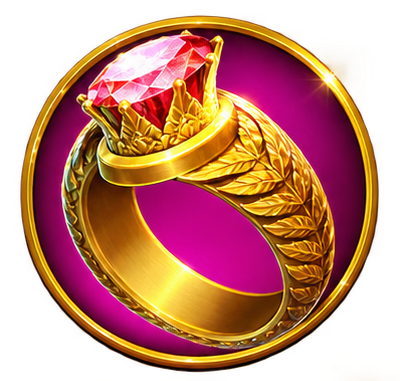

Attach: Image 1 = `refs/old-ring.png`, Image 2 = approved L1. 1:1, 1K, 1 variant(s), + master style. Output: `final/symbols/H2_astrolabe.png`.

```
Image 1 is an old symbol from our slot game. Use it only for framing and level of finish; do not keep its subject, gem, gold or badge. Image 2 is our approved new style: match its line weight, cel shading and silver finish.

Create a premium slot symbol: a floating astrolabe of at least three nested polished-silver rings set at different angles, engraved with constellation lines and tiny star dots, with a glowing ember-orange sphere at its centre. It must not read as a finger ring or jewellery. Strong silver rim light, ember and crimson glow kept tight to the object. Centred, filling about 85% of a 1:1 frame.
```

### H3: H3 Crescent Scythe (replaces Hourglass)

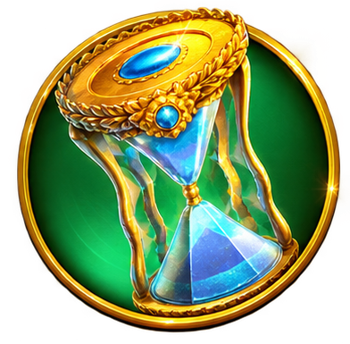

Attach: Image 1 = `refs/old-hourglass.png`, Image 2 = approved L1. 1:1, 1K, 1 variant(s), + master style. Output: `final/symbols/H3_scythe.png`.

```
Image 1 is an old symbol from our slot game. Use it only for framing and level of finish; do not keep its subject, sand, glass, gold or laurels. Image 2 is our approved new style: match its line weight, cel shading and silver finish.

Create a premium slot symbol: a silver scythe with a large crescent-moon-shaped blade whose cutting edge glows ember orange, and a haft wrapped in crimson cloth. Diagonal composition from lower left to upper right, blade at the top. Elegant and dangerous. Strong silver rim light, glow kept tight to the blade. Centred, filling about 85% of a 1:1 frame.
```

### H4: H4 Horned Eclipse Mask (replaces Crown)

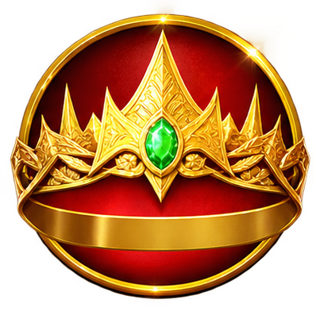

Attach: Image 1 = `refs/old-crown.png`, Image 2 = approved L1. 1:1, 1K, 1 variant(s), + master style. Output: `final/symbols/H4_mask.png`.

```
Image 1 is an old symbol from our slot game. Use it only for framing and level of finish; do not keep its subject, shape, gold, velvet or jewels. Image 2 is our approved new style: match its line weight, cel shading and silver finish.

Create the top-value slot symbol: an obsidian face mask covering the upper face and nose, with large curved ram horns sweeping back from the temples. The horn tips are capped in polished silver engraved with star maps. Eye slits glow ember orange, and a thin crimson-and-orange corona glows just behind the mask. It is a face mask, not a crown, circlet or headpiece: no band around a head and no points on top. Richest detail and strongest glow in the set, but keep the glow inside the frame. Centred, filling about 85% of a 1:1 frame.
```

### SC: SC Black Sun scatter (replaces the god-portrait scatter)

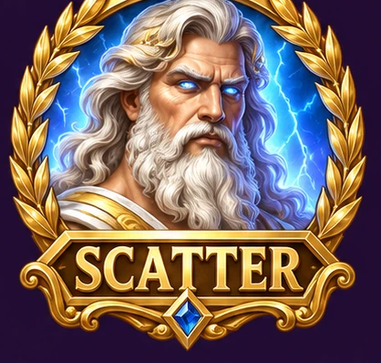

Attach: Image 1 = `refs/old-scatter.png`, Image 2 = `refs/style-H4.png`. 1:1, 1K, 2 variant(s), + master style. Output: `final/symbols/SC_black_sun.png`.

```
Image 1 is an old scatter symbol from our slot game. Use it only for framing and level of finish. Do not keep the portrait, any face or person, the laurel wreath, the gold frame or the text banner. Image 2 is our approved premium symbol: match its line weight, cel shading and glow.

Create a scatter slot symbol: a perfectly black sun disc surrounded by a blazing crimson-and-orange corona of flame tendrils, with a thin bright ember ring where the disc meets the corona. It floats free: no silver disc, plate, frame, border or outer ring behind or around it, and it must not look like our round moon symbols. Keep the whole corona inside the frame. The bottom 20% of the frame stays plain empty background for a label we add in the game: do not draw a bar, banner or panel there. No text in the image. Centred horizontally, 1:1 frame.
```

## Ember

### EMBER: Corona Ember base design (6-15x tier)

Attach: Image 1 = approved L1. 1:1, 1K, 2 variant(s), + master style. Output: `final/ember/ember_t2.png`.

```
Image 1 is our approved slot symbol style: match its line weight, cel shading and palette.

Create a multiplier symbol: a jagged, angular burning crystal shard, like a splinter broken off a sun's corona, standing upright. Ember-orange body, white-hot core, small flames licking its edges. Across the middle third, leave a slightly darker, flatter area where the game overlays a number such as 25x. Never round or orb-shaped. Glow kept tight to the shard. Centred, filling about 80% of a 1:1 frame.
```

### EMBER_T1: Corona Ember tier 1 (2-5x)

Attach: Image 1 = approved EMBER. 1:1, 1K, 1 variant(s). Output: `final/ember/ember_t1.png`.

```
Edit Image 1. Keep the exact shape and pose. Make it a smouldering ember: darker, dimmer orange, fewer and smaller flames, a faint core. Keep the solid flat pure #00FF00 green background exactly as it is.
```

### EMBER_T3: Corona Ember tier 3 (20-50x)

Attach: Image 1 = approved EMBER. 1:1, 1K, 1 variant(s). Output: `final/ember/ember_t3.png`.

```
Edit Image 1. Keep the exact shape. Make the body blood crimson with a bright orange core and crimson flames. Keep the solid flat pure #00FF00 green background exactly as it is.
```

### EMBER_T4: Corona Ember tier 4 (100-250x)

Attach: Image 1 = approved EMBER. 1:1, 1K, 1 variant(s). Output: `final/ember/ember_t4.png`.

```
Edit Image 1. Keep the exact shape. Give it a white-hot polished-silver core, crimson flames and a brighter, larger flare, still inside the frame. Keep the solid flat pure #00FF00 green background exactly as it is.
```

### EMBER_T5: Corona Ember tier 5 (500-1000x)

Attach: Image 1 = approved EMBER. 1:1, 1K, 1 variant(s). Output: `final/ember/ember_t5.png`.

```
Edit Image 1. Keep the exact shape. Make it a miniature eclipse: a black core inside the shard with a blazing crimson-and-orange corona around it. The most intense of the set. Keep the solid flat pure #00FF00 green background exactly as it is.
```

## Vfx

### VFX_SHEET: VFX elements sheet (replaces gold bursts)

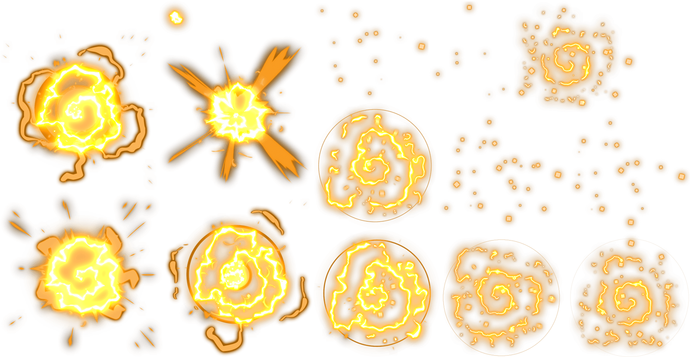

Attach: Image 1 = `refs/old-gold-bursts.png`, Image 2 = approved EMBER. 1:1, 2K, 1 variant(s). Output: `final/vfx/vfx_sheet.png`.

```
Image 1 is an old effects sheet from our slot game. Use it only for level of detail and the idea of isolated effects on a dark background. Do not keep its gold colour, swirl shapes or layout. Image 2 is our approved multiplier symbol: match its flame style and colours.

Create a 2x2 sheet of four separate visual effects with wide empty space between them, on a pure black #000000 background with nothing else in it:
1. top left: a ring of crimson-and-orange corona flame tendrils around an empty black centre;
2. top right: a radial burst of ember-orange sparks and small flame flecks;
3. bottom left: a single silver-white falling star with a long tapering tail, diagonal from upper right to lower left;
4. bottom right: a soft crimson glow puff with a few silver star specks.
Semi-realistic painterly effects, glowing, palette limited to blood crimson #C8102E, ember orange #FF7A1A and polished silver #C9CED6. No text, no borders. 1:1.
```

### VFX_BLACKOUT: Blackout explosion (100x+ win)

Attach: nothing. 1:1, 2K, 1 variant(s). Output: `final/vfx/blackout_explosion.png`.

```
A huge solar corona explosion bursting outward from a perfectly black disc in the centre: crimson and ember-orange flame tendrils and rays radiating to the edges of the frame, a thin white-hot ring around the disc, scattered silver sparks. Pure black #000000 background. Semi-realistic painterly effect, cel-shaded edges, palette limited to blood crimson #C8102E, ember orange #FF7A1A and polished silver #C9CED6. No text.
```

## Occulta

### HERO: Occulta hero (idle pose)

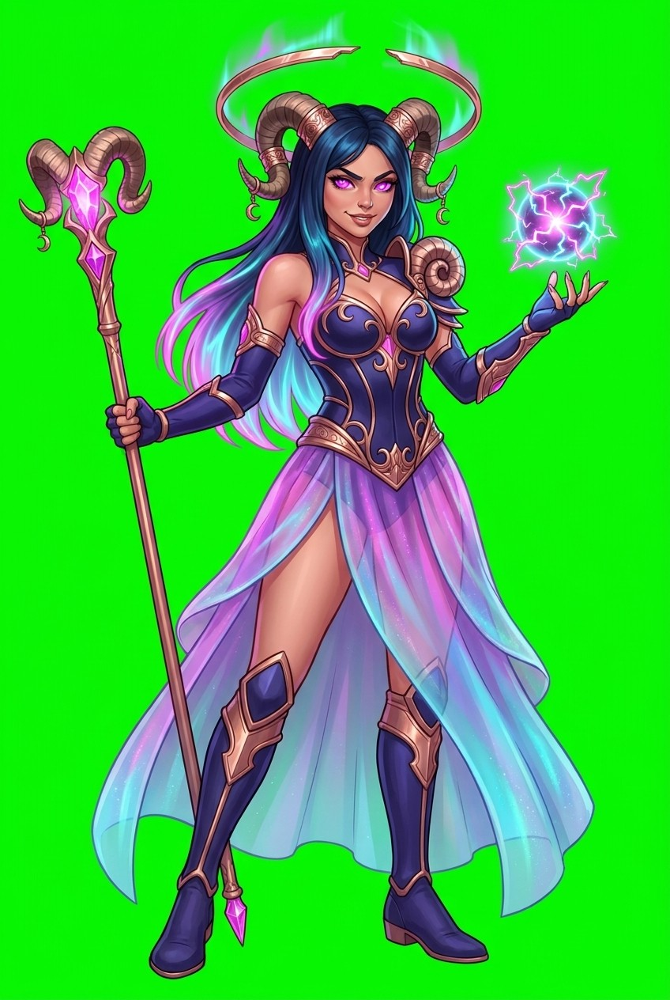

Attach: Image 1 = `refs/new-hero.png`. 2:3, 2K, 4 variant(s), + master style. Output: `final/occulta/occulta_idle.png`.

```
Image 1 is our character design for Occulta, an original goddess of the eclipse. Keep her face, eye shape, build, long straight hair and ram-horn shape exactly as in Image 1. Replace her outfit, colours, halo and props with the Eclipse version described below: no gold, purple, pink, sheer skirt, staff or lightning orb.

Full-body character art. Standing, three-quarter view, confident and regal, with a cold, amused expression and a slight smirk, never a warm smile.

Face and hair: long straight blue-black hair; eyes glowing ember orange. Large curved ram horns, tipped with polished silver caps engraved with star maps.
Halo: a huge black eclipsed sun with a blazing crimson-and-orange corona hovers behind her head.
Outfit: high-collared obsidian bodysuit; polished silver armour plates on the shoulders, ribs and hips with sharp crescent-moon edges; a long crimson cape lined with tiny glowing stars; silver thigh-high armoured boots.
Hands: her left hand holds a silver crescent-bladed scythe resting on her shoulder. Her right arm is extended forward, palm open, with a ring of crimson flame orbiting her wrist.

Whole figure in frame from horns to boots, with a little space around her; the halo fully inside the frame. 2:3 portrait.
```

### FACE_SHEET: Occulta face reference sheet

Attach: Image 1 = approved HERO. 16:9, 2K, 1 variant(s), + master style. Output: `final/occulta/occulta_face_sheet.png`.

```
Image 1 is our approved character, Occulta. Keep her face, horns, hair and eye colour exactly the same. Her horns are natural brown ram horns with ridged texture; only the tips are capped in polished silver engraved with star maps. The horns themselves are not silver.

Create a character face reference sheet: three head-and-shoulders portraits of the same woman side by side, front view, three-quarter left and three-quarter right, even lighting, neutral cold expression, horns fully visible, no halo. Same art style as Image 1.
```

### POSE_FLICK: Occulta pose: flick

Attach: Image 1 = approved HERO, Image 2 = approved FACE_SHEET. 2:3, 2K, 1 variant(s), + master style. Output: `final/occulta/occulta_flick.png`.

```
Image 1 is our approved character, Occulta; keep her outfit, horns, halo, scythe, colours and proportions exactly the same. Image 2 is her face reference; keep her face identical to it. Change only the pose described below. Full body in frame, 2:3 portrait.

Her right hand snaps forward mid-throw, fingers flicking, a burning ember shard leaving the flame ring on her wrist and flying toward the viewer. Scythe still on her shoulder.
```

### POSE_GLOAT: Occulta pose: gloat

Attach: Image 1 = approved HERO, Image 2 = approved FACE_SHEET. 2:3, 2K, 1 variant(s), + master style. Output: `final/occulta/occulta_gloat.png`.

```
Image 1 is our approved character, Occulta; keep her outfit, horns, halo, scythe, colours and proportions exactly the same. Image 2 is her face reference; keep her face identical to it. Change only the pose described below. Full body in frame, 2:3 portrait.

Chin raised, looking down at the viewer with a satisfied smirk, right hand resting on her hip, scythe on her shoulder, halo corona slightly brighter.
```

### POSE_BLACKOUT: Occulta pose: blackout

Attach: Image 1 = approved HERO, Image 2 = approved FACE_SHEET. 2:3, 2K, 1 variant(s), + master style. Output: `final/occulta/occulta_blackout.png`.

```
Image 1 is our approved character, Occulta; keep her outfit, horns, halo, scythe, colours and proportions exactly the same. Image 2 is her face reference; keep her face identical to it. Change only the pose described below. Full body in frame, 2:3 portrait.

Arms spread wide, scythe held out to the side in her left hand, cape billowing, the halo's corona flaring huge and bright behind her, her eyes blazing ember orange.
```

## Backgrounds

### BG_BASE: Base game background, desktop 16:9

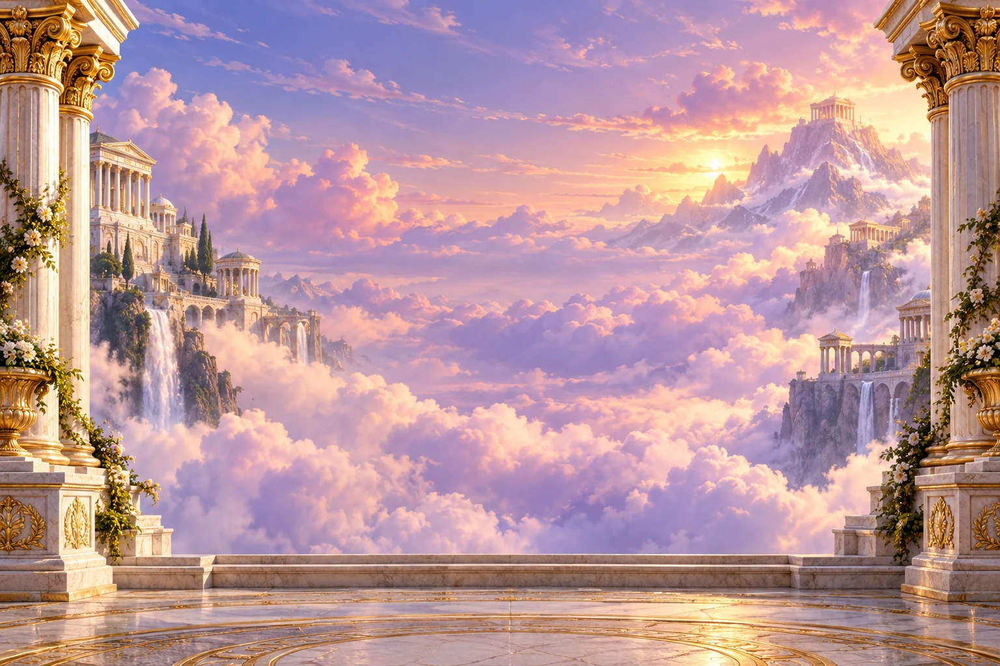

Attach: Image 1 = `refs/old-temple-background.png`. 16:9, 4K, 2 variant(s). Output: `final/backgrounds/bg_base_16x9.png`.

```
Image 1 is our old slot game background. Keep only its composition: an open, uncluttered centre where the reel grid sits, framing elements at the left and right edges, and a floor plane at the bottom. Replace everything else: no clouds, temples, marble, flowers, gold or daylight.

Create the base game background: the instant of a total solar eclipse over an obsidian landscape. A deep obsidian night sky full of sharp stars; crimson-and-orange corona light spilling down from the top centre, off-frame. Around the whole horizon, the dim crimson glow that circles the sky during totality. Jagged obsidian peaks silhouetted in the distance. In the foreground, a polished obsidian altar platform with silver crescent-moon inlays where the grid will sit. At the left and right edges, tall obsidian obelisks banded with polished silver. Keep the centre 60% dark and low-detail so symbols stay readable. No characters, no text.

Semi-realistic digital illustration, clean line art, cel shading with soft painterly gradients. Palette limited to obsidian #16121F, blood crimson #C8102E, polished silver #C9CED6 and ember orange #FF7A1A.
```

### BG_BASE_MOBILE: Base game background, mobile 9:16


Attach: Image 1 = `refs/old-temple-background.png`, Image 2 = approved BG_BASE. 9:16, 4K, 1 variant(s). Output: `final/backgrounds/bg_base_9x16.png`.

```
Image 2 is our approved desktop version of this background: keep its content, lighting and art style exactly, recomposed for a tall 9:16 portrait phone screen with the altar in the lower half.

Image 1 is our old slot game background. Keep only its composition: an open, uncluttered centre where the reel grid sits, framing elements at the left and right edges, and a floor plane at the bottom. Replace everything else: no clouds, temples, marble, flowers, gold or daylight.

Create the base game background: the instant of a total solar eclipse over an obsidian landscape. A deep obsidian night sky full of sharp stars; crimson-and-orange corona light spilling down from the top centre, off-frame. Around the whole horizon, the dim crimson glow that circles the sky during totality. Jagged obsidian peaks silhouetted in the distance. In the foreground, a polished obsidian altar platform with silver crescent-moon inlays where the grid will sit. At the left and right edges, tall obsidian obelisks banded with polished silver. Keep the centre 60% dark and low-detail so symbols stay readable. No characters, no text.

Semi-realistic digital illustration, clean line art, cel shading with soft painterly gradients. Palette limited to obsidian #16121F, blood crimson #C8102E, polished silver #C9CED6 and ember orange #FF7A1A.
```

### BG_ECLIPSE: Eclipse Spins background, desktop 16:9

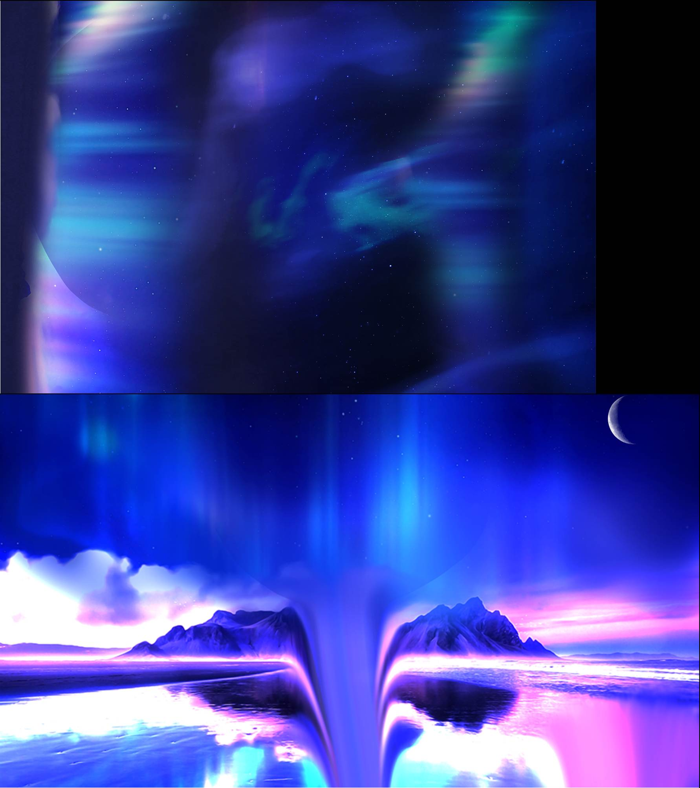

Attach: Image 1 = `refs/old-bonus-sky.png`, Image 2 = approved BG_BASE. 16:9, 4K, 1 variant(s). Output: `final/backgrounds/bg_eclipse_16x9.png`.

```
Image 1 is an old bonus-round sky. Use it only for its mood of a transformed, more intense sky; do not keep its blue colours, water, mountains or light beam. Image 2 is our approved base game background: keep its composition, altar, obelisks and art style exactly.

Create the bonus-round version of Image 2: deeper totality. The sky is darker, with more stars, and long crimson corona streamers arc across it like slow flames. The horizon glow is stronger and redder. Tiny ember-orange sparks drift upward from the altar. The centre 60% stays dark and low-detail for the grid. No characters, no text.
```

### BG_ECLIPSE_MOBILE: Eclipse Spins background, mobile 9:16


Attach: Image 1 = `refs/old-bonus-sky.png`, Image 2 = approved BG_BASE_MOBILE. 9:16, 4K, 1 variant(s). Output: `final/backgrounds/bg_eclipse_9x16.png`.

```
Image 1 is an old bonus-round sky. Use it only for its mood of a transformed, more intense sky; do not keep its blue colours, water, mountains or light beam. Image 2 is our approved base game background: keep its composition, altar, obelisks and art style exactly.

Create the bonus-round version of Image 2: deeper totality. The sky is darker, with more stars, and long crimson corona streamers arc across it like slow flames. The horizon glow is stronger and redder. Tiny ember-orange sparks drift upward from the altar. The centre 60% stays dark and low-detail for the grid. No characters, no text.
```

## Ui

### PILLAR: Side pillar and nameplate (replaces Pragmatic's pillar)

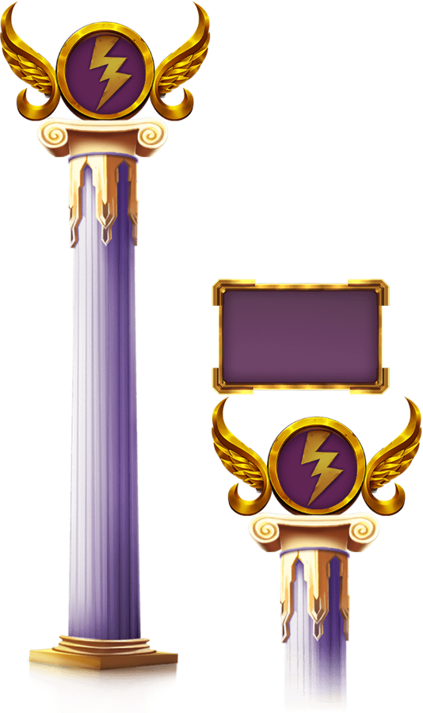

Attach: Image 1 = `refs/old-pillars.png`, Image 2 = approved H4. 9:16, 2K, 1 variant(s), + master style. Output: `final/ui/pillar_and_nameplate.png`.

```
Image 1 is an old decorative pillar and nameplate. Keep only the idea: a tall decorative column with a medallion on top, plus a small separate nameplate panel. Do not keep the classical column, gold, wings or lightning bolt. Image 2 is our approved premium symbol: match its silver finish and glow.

Create two separate items side by side with space between them: 1) a tall obsidian obelisk banded with polished-silver armour plates with sharp crescent-moon edges and faint star-map engravings, topped by a round medallion showing a black sun with a crimson corona; 2) a small horizontal polished-silver nameplate with crescent-moon end caps and an empty obsidian centre for UI text.
```

### LOGO: Logo

Attach: nothing. 16:9, 2K, 2 variant(s), + master style. Output: `final/ui/logo.png`.

```
Game logo lettering reading "GOATED GODDESS" on the main line, with "1000" beneath it and a smaller subtitle "ECLIPSE" under that. Custom sharp-serifed letters in polished silver with crisp bevels. The O in GODDESS is replaced by a black eclipsed sun with a blazing crimson-and-orange corona. A pair of curved ram horns with silver-capped tips frames the word GODDESS. "1000" in glowing ember orange. Premium, dark, regal. Centred, all text fully inside the frame, spelled exactly as written.
```
